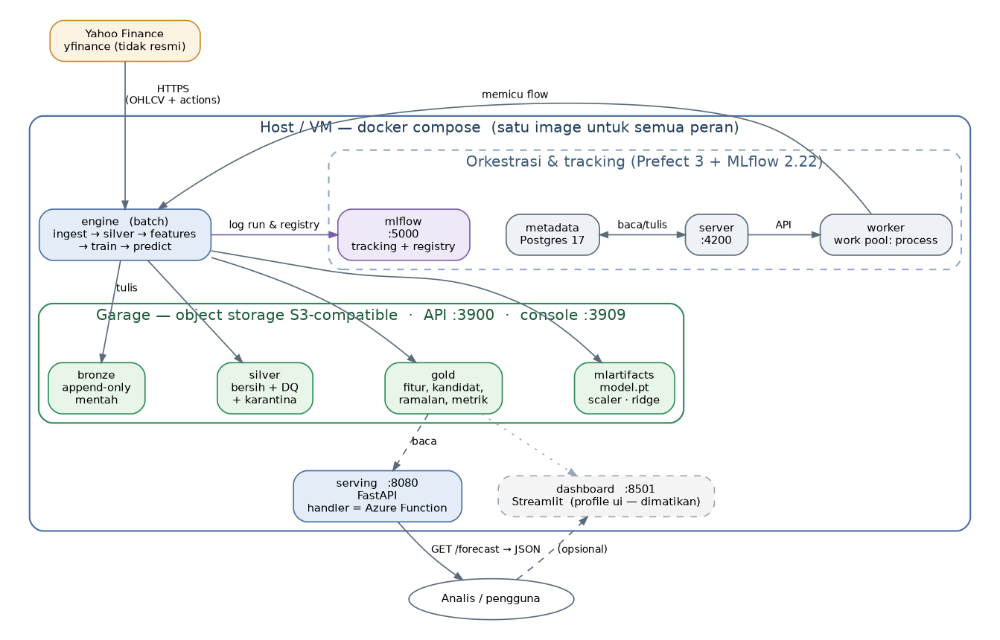
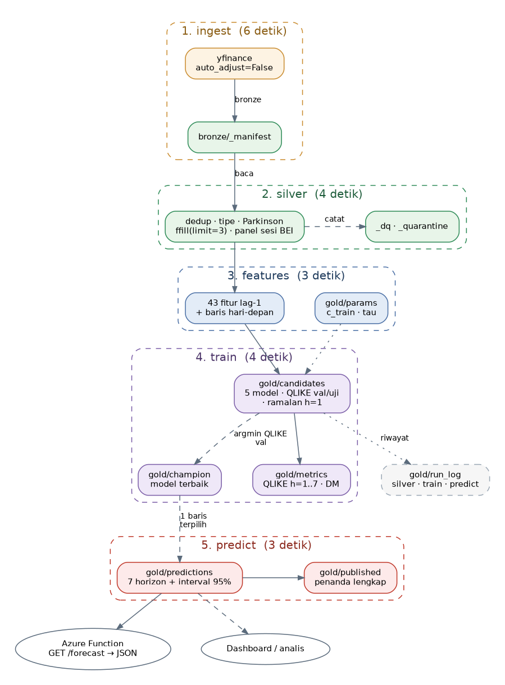

# IHSG Forecasting Engine — on-prem (Docker) → Azure

Pipeline otomatis untuk meramalkan **volatilitas & return IHSG (`^JKSE`)** 1–7 hari
bursa, dengan arsitektur medallion (bronze/silver/gold) di atas object storage
S3-compatible, orkestrasi Prefect, model deep learning GRU, dan output JSON lewat
Azure Function.

> **Status:** sudah dijalankan end-to-end di Docker Compose (Garage + Prefect image
> + serving). Hasil nyata ada di bagian 11; yang belum dikerjakan di bagian 12.

---

## 1. Arsitektur

### 1.1 Deployment — on-prem (Docker Compose)



*Gambar 1.* Satu image dipakai untuk semua peran (batch, Prefect, serving,
dashboard). Garage menyimpan keempat layer medallion; `serving` hanya membaca
`gold`. Versi vektor untuk laporan: [`docs/architecture.svg`](docs/architecture.svg).

### 1.2 Alur data — medallion per tahap



*Gambar 2.* Batas tiap tahap beserta waktu nyata dan tabel yang dihasilkan.
Perhatikan bahwa `gold/candidates` menjadi satu-satunya sumber `predict`, sehingga
prediksi tidak bisa menyimpang dari hasil evaluasi.
Versi vektor: [`docs/dataflow.svg`](docs/dataflow.svg).

### 1.3 Pemetaan ke Azure

| Docker (sekarang) | Azure (nanti) | Perubahan kode |
|---|---|---|
| `garage` | Storage Account (Blob / ADLS Gen2) | implementasi `Sink` baru |
| `engine` + `prefect-worker` | Container Apps Job (timer trigger) | nol — image sama |
| `serving` | Azure Function (HTTP) | `function_app/` sudah ada |
| `dashboard` | Container App (min replica 0) | nol |

Detail perintah `az` ada di [bagian 9](#9-migrasi-ke-azure).

### 1.4 Poin desain yang menentukan

| Keputusan | Alasan |
|---|---|
| **Satu image** untuk engine, Prefect, serving, dashboard | satu versi library = satu perilaku. Image yang sama dipakai ulang di Azure. |
| **Handler serving murni** (`ihsg/serving/handler.py`) | FastAPI lokal dan Azure Function memanggil fungsi yang sama → tidak mungkin berbeda. |
| **Inference di job, bukan di request** | request hanya membaca Parquet (cepat, murah, deterministik). Model artifact tetap disimpan untuk audit. |
| **`gold/candidates` sebagai sumber prediksi** | menghapus train/serve skew: yang dievaluasi = yang diprediksi. |
| **Champion–challenger** | retrain tidak boleh otomatis menurunkan kualitas produksi. |
| **`run_id` deterministik** | retry orkestrator tidak menghasilkan duplikat palsu. |
| **MLflow bersifat deskriptif** | `gold/champion` tetap sumber kebenaran operasional; MLflow mati tidak menghentikan produksi. |

### 1.5 Tracking & versioning (MLflow)

MLflow 2.22 menempel di setiap `train`:

| Yang dikirim | Isi |
|---|---|
| **Params** | 26 nilai: `window`, `horizons`, `seed`, `hidden`, `learning_rate`, `selected_model`, `tau`, `c_train`, batas split |
| **Metrics** | 49 nilai: QLIKE val/uji tiap kandidat, QLIKE uji h=2..7, AUC/precision/recall rezim, R²_OS, p Clark–West |
| **Tags** | `ihsg_run_id`, `as_of`, `data_fingerprint`, `config_hash`, `git_sha`, `trigger`, `selected_model`, `promoted` |
| **Artifacts** | `model.pt`, `scaler.parquet`, `ridge.joblib` → `s3://mlartifacts/mlflow/<exp>/<run>/artifacts/` |
| **Model registry** | `ihsg-champion` (+ alias `champion`) — hanya dibuat saat promosi |

Aturan versi:

- versi bertambah **hanya** ketika challenger dipromosikan,
- melatih ulang `as_of` + konfigurasi yang sama adalah **no-op** (`run_id` deterministik) → tidak menambah versi,
- `gold/champion` menyimpan `mlflow_run_id` dan `mlflow_version`, jadi model produksi bisa dilacak ke satu versi registry.

```bash
make mlflow       # http://localhost:5000  (sudah ikut `make up`)
```

Model versi champion bisa dimuat ulang dan mereproduksi ramalan produksi:

```python
import mlflow
model = mlflow.pyfunc.load_model("models:/ihsg-champion@champion")
model.predict(None)   # 7 baris varians + volatilitas, identik dengan gold/predictions
```

> Diagram dibuat dari sumber teks di `docs/architecture.dot` dan `docs/dataflow.dot`,
> lalu dirender dengan Graphviz. Regenerate: `make diagram`.

---

## 2. Struktur direktori

```
├── compose.yaml                  # Garage + Prefect + engine + serving + dashboard
├── Dockerfile                    # SATU image untuk semua peran
├── Makefile                      # perintah harian
├── requirements.txt              # versi di-pin (kecuali torch, dipasang di Dockerfile)
├── config/
│   ├── garage.toml               # single node, replication 1
│   ├── garage-init/              # bootstrap bucket via Admin API v2 (idempoten)
│   └── mlflow/                   # image MLflow + boto3 (artefak ke Garage)
├── ihsg/
│   ├── config.py                 # Settings dari env + config_hash
│   ├── instruments.py            # ticker ↔ key partisi
│   ├── dataset.py                # konvensi path medallion + kalender bursa
│   ├── storage.py                # Sink: LocalSink / S3Sink
│   ├── schemas.py                # kontrak kolom tiap tabel
│   ├── quality.py                # hard/soft DQ + quarantine
│   ├── indicators.py             # Parkinson, log-return, EWMA
│   ├── eval.py                   # QLIKE, DM, Clark-West, Pesaran-Timmermann, AUC
│   ├── ratelimit.py              # throttle + retry yfinance
│   ├── providers/                # yfinance (auto_adjust=False)
│   ├── models/                   # baseline ekonometrik + GRU (torch)
│   ├── pipelines/                # ingest, silver, features, train, predict
│   ├── tracking.py               # integrasi MLflow (opsional, gagal-tidak-fatal)
│   ├── champion_model.py         # resep champion sebagai model pyfunc
│   ├── serving/                  # handler murni + FastAPI lokal
│   └── dashboard/                # Streamlit
├── orchestration/
│   ├── serve.py                  # 2 deployment + jadwal WIB (sumber kebenaran)
│   └── flows/                    # flow tipis yang memanggil ihsg.pipelines
├── function_app/                 # Azure Function (HTTP trigger)
├── docs/
│   ├── contracts.md              # spesifikasi tiap tabel (bahan Bab 2/3)
│   ├── architecture.dot|png|svg  # diagram deployment (sumber + hasil render)
│   └── dataflow.dot|png|svg      # diagram medallion per tahap
└── tests/                        # unit test tanpa jaringan/Docker
```

---

## 3. Mulai cepat

```bash
cp .env.example .env
# isi secret: openssl rand -hex 32 (GARAGE_*), dan IDX_HOLIDAYS dari kalender BEI

make up            # Garage + WebUI + init + Prefect + API
make doctor        # cek tulis/baca storage
make run AS_OF=auto   # ingest -> silver -> features -> predict (butuh champion)

# champion belum ada pada run pertama, jadi latih dulu:
make run AS_OF=auto    # predict akan gagal dengan pesan jelas
make train AS_OF=auto  # latih GRU + promosi champion
make predict AS_OF=auto
```

Setelah itu:

- Garage console: <http://localhost:3909>
- Prefect UI: <http://localhost:4200>
- API: <http://localhost:8080/forecast/latest>
- Dashboard: `make dash` → <http://localhost:8501>

---

## 4. Medallion: apa yang disimpan di mana

| Layer | Prefix | Sifat | Isi |
|---|---|---|---|
| **bronze** | `bronze/yf/prices/ticker=<K>/ingest_date=<D>/` | **append-only**, tidak pernah ditimpa | OHLCV mentah (`auto_adjust=False`), nama kolom asli Yahoo |
| | `bronze/yf/actions/ticker=<K>/…` | append-only | dividen & split mentah |
| | `bronze/yf/_manifest/ingest_date=<D>/` | append-only | baris per ticker: jumlah baris, rentang, fingerprint, versi yfinance |
| **silver** | `silver/prices/ticker=<K>/` | ditimpa penuh (turunan) | dedup, tipe, `ret_cc_pct`, `park_var`, `source_ingest_date` |
| | `silver/panel/as_of=<D>/` | upsert per partisi | panel lebar pada sesi BEI + `ffill(limit=3)` + `is_filled_<K>` |
| | `silver/_dq/as_of=<D>/` | ditimpa | hasil pemeriksaan kualitas (hard/soft/info) |
| | `silver/_quarantine/as_of=<D>/` | ditimpa | baris yang dibuang + alasannya |
| **gold** | `gold/features/as_of=<D>/` | ditimpa | matriks fitur ber-lag + target |
| | `gold/params/as_of=<D>/` | ditimpa | `c_train`, `tau`, LRV, batas split |
| | `gold/predictions/as_of=<D>/` | ditimpa | ramalan 1..7 hari (**sumber JSON**) |
| | `gold/candidates/as_of=<D>/` | ditimpa | QLIKE + ramalan h=1 semua kandidat; sumber `predict` |
| | `gold/published/as_of=<D>/` | ditimpa | penanda prediksi lengkap (handler menolak tanpa ini) |
| | `gold/regime/as_of=<D>/` | ditimpa | probabilitas rezim HIGH |
| | `gold/regime_eval/as_of=<D>/` | ditimpa | klasifikasi periode uji (bahan dashboard) |
| | `gold/vol_eval/as_of=<D>/` | ditimpa | varians aktual vs GRU/HAR/EWMA/hist |
| | `gold/metrics/as_of=<D>/` | ditimpa | metrik panjang (model × metric × split) |
| | `gold/run_log/as_of=<D>/stage=<S>/run_id=<R>/` | upsert per entri | riwayat run/retrain (**bukti retrain >3×**) |
| | `gold/champion/` | ditimpa bila promosi | model produksi saat ini (satu baris) |
| **mlartifacts** | `mlartifacts/run_id=<R>/` | immutable per run | `model.pt`, `scaler.parquet`, `ridge.joblib` |
| | `mlartifacts/mlflow/<exp>/<run>/` | dikelola MLflow | artefak run + bundel model registry |

Tidak ada CSV. Tidak ada JSON sebagai media penyimpanan — JSON hanya muncul sebagai
**response HTTP** di serving.

Detail kolom per tabel: [`docs/contracts.md`](docs/contracts.md).

---

## 5. Perintah

| Perintah | Fungsi |
|---|---|
| `make up` / `make down` | daemon: Garage, Prefect, API |
| `make doctor` | tulis/baca probe + hitung objek per layer |
| `make ingest` | unduh bronze (inkremental, append-only) |
| `make silver` | bangun silver + DQ + quarantine |
| `make features` | bangun `gold/features` + `gold/params` |
| `make train` | latih GRU, evaluasi validasi, gate promosi, tulis artefak |
| `make predict` | ramalan 1..7 hari dari champion |
| `make run` | pipeline lengkap sekali jalan |
| `make backfill START=… END=…` | pipeline per hari bursa (retrain ikut) |
| `make retrain4` | 4 retrain pada 4 tanggal → memenuhi bonus “retrain > 3×” |
| `make mlflow` | MLflow UI (http://localhost:5000) |
| `make dash` | dashboard Streamlit |
| `make test` / `make lint` | unit test / ruff |

Semua perintah mendukung `AS_OF=YYYY-MM-DD` atau `AS_OF=auto`
(hari bursa terakhir yang sesinya sudah selesai, berdasarkan `IDX_HOLIDAYS`).

---

## 6. Otomatisasi & retrain

Prefect 3 dijalankan sebagai **satu container `prefect-serve`** yang mendaftarkan
deployment sekaligus mengeksekusinya (tanpa work pool, tanpa `prefect deploy`,
tanpa `docker.sock`). Jadwal didefinisikan di `orchestration/serve.py`:

| Deployment | Cron (WIB) | Isi |
|---|---|---|
| `ihsg-daily-predict` | `15 5 * * 1-5` | ingest → silver → features → **train bila `gold/candidates` hari itu belum ada** → predict |
| `ihsg-weekly-retrain` | `0 6 * * 6` | sama, dengan train eksplisit (gate promosi) |
| backfill | manual | `make backfill START=… END=…` |

Terbukti berjalan: deployment terdaftar dengan `paused=false`, jadwal berikutnya
22:15Z (= 05:15 WIB) dan 23:00Z Sabtu (= 06:00 WIB), serta satu run manual
lewat `prefect deployment run` berakhir `COMPLETED` dan menulis
`gold/run_log` dengan `trigger=schedule`.

Kenapa job harian ikut melatih: `predict` membaca `gold/candidates` (ramalan h=1
semua model), dan tabel itu dihasilkan oleh tahap train. Biayanya ±3 detik, dan
gate promosi memastikan champion tidak berubah hanya karena dijalankan ulang.

Kenapa 05:15 WIB: data **EEM/^DJI** (fitur utama) baru final setelah pasar AS
tutup (±04:00 WIB), sedangkan BEI buka 09:00 WIB.

Gate promosi: **kandidat dengan QLIKE validasi terendah** (di antara GRU, HAR,
GARCH, EWMA, historis) menggantikan champion hanya bila lebih baik. Kalau kalah,
tetap tercatat di `gold/run_log` (`promoted=false`).

```bash
curl -X POST http://localhost:8080/admin/retrain -H "X-Admin-Token: $ADMIN_TOKEN"
```

---

## 7. Bentuk output (JSON dari Function)

```json
{
  "metadata": {"service": "…", "schema_version": 1, "as_of": "2026-11-13",
               "base_date": "2026-11-13", "last_close": 5057.05, "run_id": "…",
               "data_fingerprint": "…", "config_hash": "…", "deterministic": true},
  "model": {"volatility": "gru", "return": "ridge", "ml_return_enabled": true,
            "tau_vol_pct": 1.82, "persistence": 0.94},
  "validation": {"gru_qlike_val": 0.24, "gru_qlike_test": 0.51, "har_qlike_test": 0.49},
  "forecast_horizons": [
    {"horizon_step": 1, "target_date": "2026-11-16",
     "forecast_volatility_pct": 2.38, "annualized_volatility_pct": 37.79,
     "risk_regime": "HIGH", "prob_high": 0.62,
     "median_close_price": 5041.33,
     "price_interval_95": [4811.49, 5282.14], "direction_signal": "DOWN"}
  ],
  "summary": {"horizon_days": 7, "regime_h1": "HIGH"},
  "data_quality": {"checks": 12, "failed": 1, "soft_failed": 1}
}
```

Tidak ada timestamp dinding di payload → dua request pada `as_of` yang sama
menghasilkan byte identik (`make`-nya bisa diverifikasi dengan `ihsg.cli verify`).

---

## 8. Determinisme

| Sumber variasi | Penanganan |
|---|---|
| Data berubah karena Yahoo merevisi | bronze append-only per `ingest_date` + fingerprint; payload menyebut fingerprint |
| Urutan fitur | daftar fitur disimpan di `scaler.parquet`, dipakai ulang saat predict |
| Threading BLAS | `OMP_NUM_THREADS=1` di compose |
| Bobot model | `torch.manual_seed`, `set_num_threads(1)`, early stopping pada loss validasi |
| Retry orkestrator | `run_id = sha256(as_of + config_hash + data_fingerprint)` |
| Versi library | semua di-pin; `model.pt` hanya kompatibel dengan versi tersebut |

Yang **tidak** deterministik dan sengaja diterima: kolom informasional
`duration_s`, `git_sha`, dan stderr log.

---

## 9. Migrasi ke Azure

| Docker | Azure | Perubahan kode |
|---|---|---|
| `garage` | Storage Account (Blob) / ADLS Gen2 | implementasi `Sink` baru (`ABFSSink`), sisa kode tetap |
| `engine` + `prefect-worker` | **Container Apps Job** (schedule) | nol — image sama, cukup `--cron-expression` |
| `serving` | **Azure Functions** (HTTP) | `function_app/` sudah ada |
| `dashboard` | Container App (min replica 0) | nol |
| `.env` | App Settings + Key Vault | ganti sumber env |

```bash
az acr build -r <acr> -t ihsg-engine:4.2.0 .
az containerapp job create --name ihsg-daily --trigger-type Schedule \
  --cron-expression "15 5 * * 1-5" --image <acr>.azurecr.io/ihsg-engine:4.2.0 \
  --command "python -m ihsg.cli run --as-of auto"
az functionapp create --consumption-plan-location southeastasia \
  --runtime python --runtime-version 3.11 --functions-version 4 \
  --name ihsg-fn --storage-account <sa>
func azure functionapp publish ihsg-fn
```

Estimasi biaya bulanan: ACR Basic ±$5 (item terbesar), ACA Job ±$0.1,
Functions free tier, Blob <$0.1 → **jauh di bawah batas $80**.

---

## 10. Pemenuhan requirement

| Requirement | Status | Bukti |
|---|---|---|
| Pipeline otomatis | ✅ | Prefect 2 jadwal + `concurrency_limit: 1` |
| Output lewat Azure Function (JSON) | ✅ | `function_app/` + handler yang sama dengan `serving` |
| Non CSV / non JSON (penyimpanan) | ✅ | semua layer Parquet; JSON hanya response |
| Parquet/ORC (bonus) | ✅ | seluruh medallion |
| Bronze tidak diapa-apakan | ✅ | append-only + guard `exists()` + `auto_adjust=False` |
| ML/DL (bukan tabular) | ✅ | GRU atas window 22 hari × 43 fitur, 2 head |
| Output ML wajib | ✅ | `gold/predictions`, `gold/regime`, `gold/metrics` |
| Inference | ✅ | `serving` + Function (inference di job, opsi live) |
| Dashboard hasil ML (bonus) | ✅ | `gold/vol_eval` + `gold/regime_eval` |
| UI (bonus) | ✅ | Streamlit (dashboard + UI menyatu) |
| Retrain > 3× (bonus) | ✅ | `make retrain4` → 4 baris `gold/run_log` |
| Trigger retrain (bonus) | ✅ | `POST /admin/retrain` + jadwal mingguan |
| Cost < $80 (bonus) | ✅ | ±$5/bulan di Azure, $0 di lokal |

---

## 11. Hasil run nyata (20 November 2026)

Data: 2.144 baris panel, 2.109 baris fitur × 43 fitur, `as_of = 2026-11-19`.

| Tahap | Durasi |
|---|---|
| ingest (2018→2026, 8 ticker) | 6,3 s |
| silver | 3,6 s |
| features | 3,4 s |
| train (5 kandidat + evaluasi h=1..7) | 3,5 s |
| predict | 3,3 s |
| train + logging MLflow | +15 s (unggah artefak + registry) |

QLIKE varians kumulatif pada **data uji**:

| Model | h=1 | h=2 | h=4 | h=7 |
|---|---|---|---|---|
| gru | 0,7655 | 0,7731 | 0,7711 | 0,7721 |
| garch | 0,5693 | 0,5632 | 0,5527 | 0,5645 |
| **har** | **0,4898** | **0,4040** | **0,3591** | **0,3829** |
| ewma | 0,6546 | 0,6624 | 0,6749 | 0,7144 |
| hist | 1,0374 | 0,9112 | 0,8249 | 0,7718 |

Temuan yang dilaporkan apa adanya:

- **GRU kalah dari HAR di semua horizon** (DM p = 0,0002 pada h=1). Ini konsisten
  dengan Hansen & Lunde (2005) dan hasil notebook: DL tidak otomatis mengalahkan
  model long-memory sederhana.
- **GARCH dipilih** karena QLIKE validasi h=1 terendah (0,2740). Di data uji HAR
  ternyata lebih baik (0,4898 vs 0,5693) — pergeseran rezim, bukan bug.
- Model return **gagal gate** (R²_OS validasi −0,012), sehingga produksi memakai
  rata-rata historis dan `direction_signal = NO_SIGNAL`.
- Klasifikasi rezim HIGH: AUC 0,771, precision 0,628, recall 0,360, base rate 17,8%.

---

## 12. Yang belum dikerjakan (jujur)

1. **GRU belum di-refit walk-forward.** Baseline (HAR/GARCH) di-refit tiap 21 hari;
   GRU dilatih sekali di 60% data. Jadi perbandingan DL vs baseline **belum
   sepenuhnya setara** — ini perbaikan berikutnya yang paling berdampak.
2. **`IDX_HOLIDAYS` masih kosong** di `.env.example` — wajib diisi dari kalender
   resmi BEI, kalau tidak `target_date` bisa jatuh di hari libur.
3. **Dashboard dimatikan** (profil `ui`). Kode tersedia dan pernah diuji render,
   tetapi tidak termasuk lingkup saat ini.
4. **Belum ada uji integrasi otomatis** (golden hash) di CI; verifikasi hash masih
   manual lewat `ihsg.cli verify`.
5. **Multi-node Garage** (replication 2) belum dicoba.
6. `requirements.txt` memuat `pytest`/`ruff` agar `make test` bisa jalan di image
   tunggal — kompromi yang disengaja, bukan praktik produksi ideal.
7. **Azure Function belum di-deploy**; baru padanan lokalnya (`serving`) yang hidup.

---

## 13. Batasan yang perlu ditulis di laporan

- yfinance adalah sumber **tidak resmi**: bisa terlambat, membalas kosong, atau
  membatasi laju. Karena itu bronze disimpan append-only — satu-satunya cara
  mereproduksi hasil saat provider berubah.
- Proxy volatilitas (Parkinson terskala) **tidak bias** terhadap varians sebenarnya
  hanya bila asumsi Parkinson terpenuhi; karena itu `gold/metrics` selalu
  dilaporkan bersama alternatif squared return bila diperlukan.
- Immutability bronze ditegakkan **di aplikasi**, bukan oleh storage
  (Garage tidak punya object-lock/versioning). Ini keterbatasan yang harus
  disebut, bukan disembunyikan.
